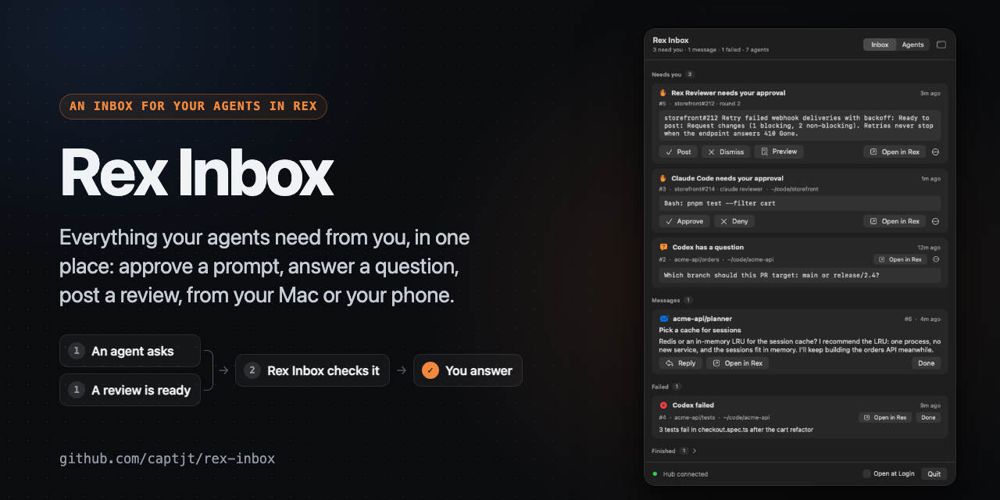
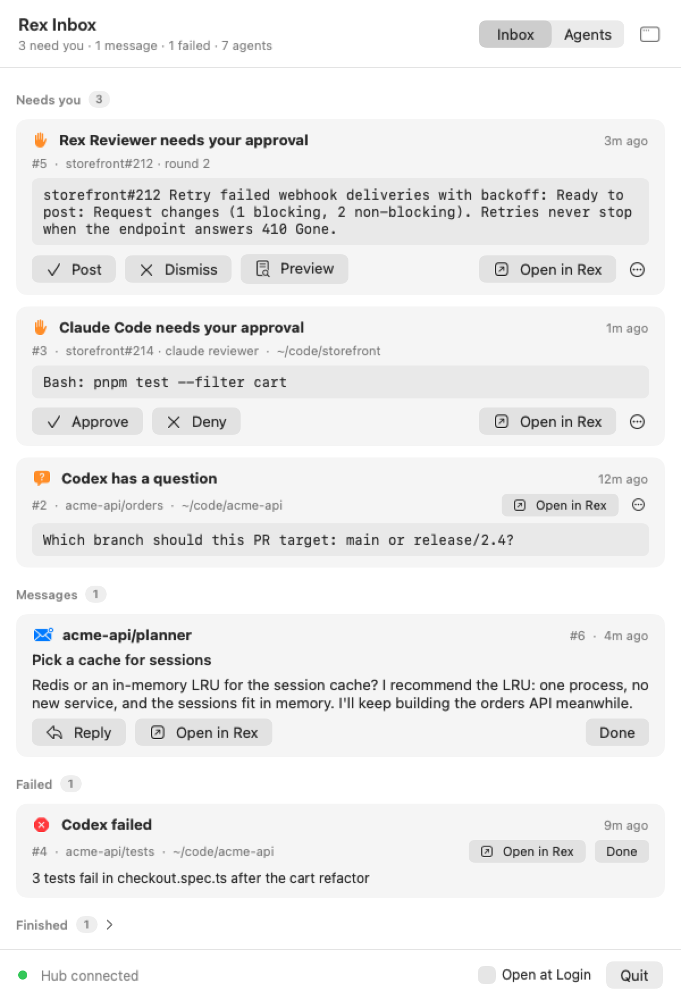
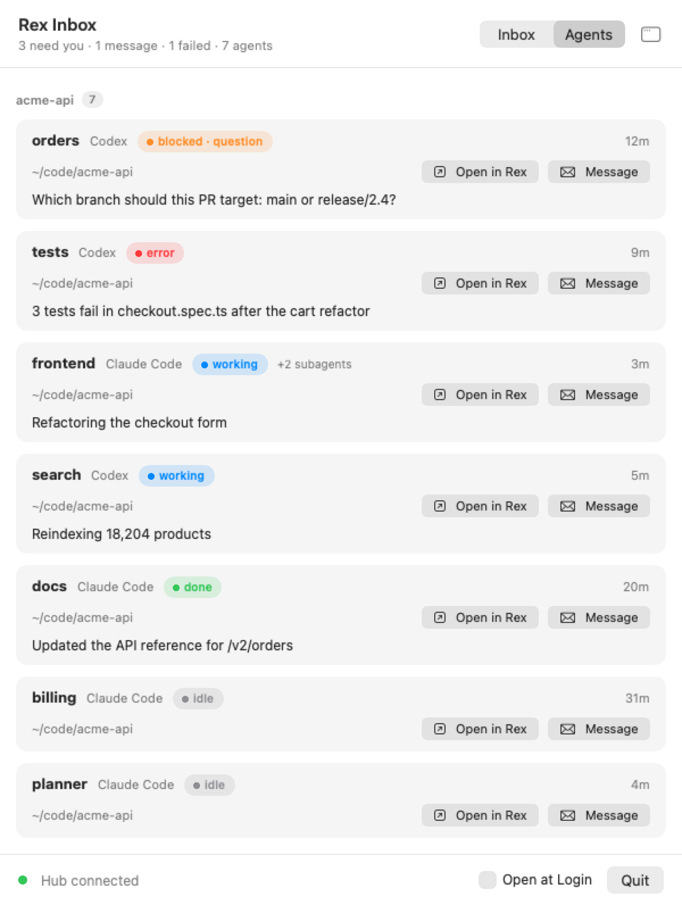
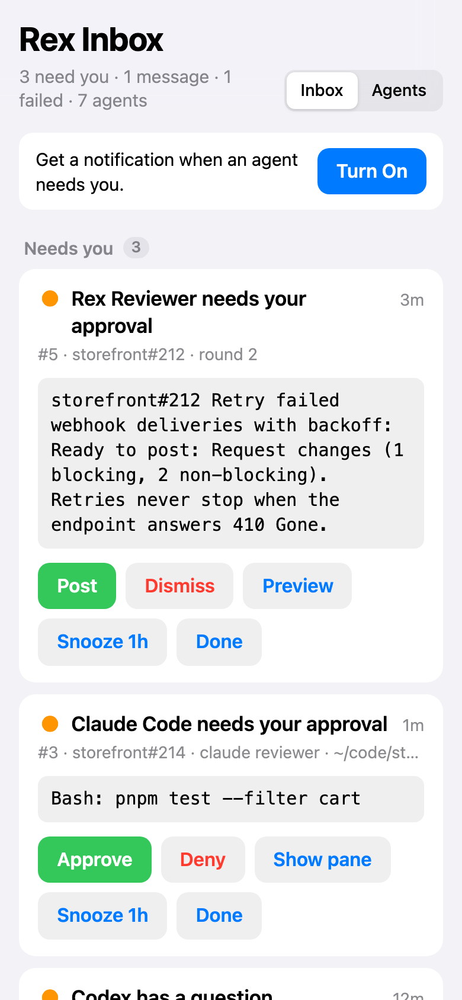
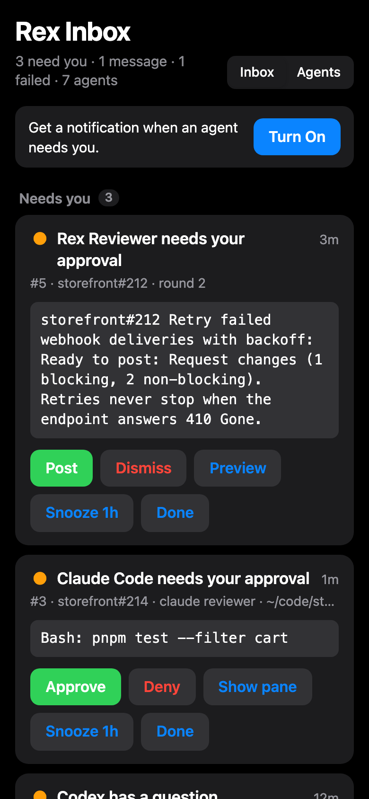

# rex-inbox



Everything your Rex agents need from you, and messages between them.

[Rex](https://www.superlogical.com/rex) already runs your agents' panes and
knows what each one is doing: Claude Code and Codex report `working`,
`blocked`, `done` and `error` on their own (OSC 7501). rex-inbox turns that
into one inbox, lets agents message each other and you, and lets you
answer permission prompts without going to the pane.

```
$ rex-inbox ls
Needs you
  #17  permission  Claude Code  solar-isle/alpha  ~/git/app  12s  approve Bash: rm approved.txt
Finished
  #12              Claude Code  restless-cliff/shell  ~/git/web  4m
Messages
  #7   unread  from solar-isle/planner  1m  Pick a cache

$ rex-inbox approve 17
#17 approved; the pane is now working
```

> Rex is in private beta. rex-inbox needs a Rex build whose agents report
> program status: Claude Code and Codex do on their own.

## Requirements

- macOS and Rex
- Rust (edition 2024), for the hub and the CLI
- Swift 6 (Xcode or its command line tools), for the Mac app
- Optional: `terminal-notifier`, for clickable notifications when the Mac
  app isn't running; `jq` and `sqlite3`, for `scripts/demo.sh`; those plus
  Node 22 or later and Google Chrome, for `scripts/screenshots.sh`

## Install

```sh
git clone https://github.com/captjt/rex-inbox ~/src/rex-inbox
cd ~/src/rex-inbox
cargo install --path .
rex-inbox up          # the hub, as a LaunchAgent (logs: rex-inbox logs)
mac/build.sh          # Rex Inbox.app, in ~/Applications
```

macOS only for now. The hub talks to Rex only through the `rex` CLI.
Agents use it through the same CLI: `rex-inbox send`, `inbox`, `read`, and
`wait`.

## The Mac app

A tray in the menu bar turns orange with a count while something needs
you. Its panel is a quick look; the window button opens a full window with
a sidebar (Everything, Needs You, Messages, Failed, Finished, Agents). The
app shows in the Dock while that window is open.

<table>
  <tr>
    <td valign="top">
      <picture>
        <source media="(prefers-color-scheme: dark)" srcset="docs/images/inbox-dark.png">
        
      </picture>
    </td>
    <td valign="top">
      <picture>
        <source media="(prefers-color-scheme: dark)" srcset="docs/images/agents-dark.png">
        
      </picture>
    </td>
  </tr>
</table>

<sub>The agents and PRs are made up. <code>scripts/screenshots.sh</code> renders these again from a made-up Rex.</sub>

- **Inbox:** approve or deny a prompt, reply to a message, open the pane in
  Rex, snooze, or mark done.
- **Agents:** every agent pane by session; click one to open it, or
  message it.
- **Notifications** carry the answer: Approve and Deny, Post and Dismiss
  for a review, or Reply.

`RexInbox --snapshot out.png [--tab agents] [--window]` renders the panel
(or the window) to a PNG without opening anything on screen.

`scripts/demo.sh up` fills your inbox with a made-up project (a Rex session
`acme-api` of stand-in agents, and two messages to you), to try the app
without real agents; `scripts/demo.sh down` removes it.

## On your phone

The hub also serves a web app. Publish it on your tailnet, then add it to
your Home Screen for notifications. It needs no App Store and no
developer account.

<p>
  
  &nbsp;
  
</p>

```sh
brew install --cask tailscale   # sign in; same tailnet as the phone
# Tailscale admin console: turn on MagicDNS and HTTPS certificates
tailscale serve --bg 7430
rex-inbox web                   # prints the phone's address
```

Open that address in Safari, choose Share › Add to Home Screen, open it
from the Home Screen, and tap Turn On. Only your own Tailscale user gets
in. Web notifications on iOS have no buttons, so tap one, then approve in
the app.

## Commands

| | |
| --- | --- |
| `ls [--all] [--history]` | What needs you: blocked, failed and finished agents, and messages to you. |
| `agents [--all]` | Every agent pane, where it is, and what it's doing. |
| `show N [--screen]` | One item; `--screen` adds the bottom of its pane. |
| `approve N`, `deny N` | Answer a permission prompt, only if it's still the one `N` shows. For a review [rex-reviewer](#with-rex-reviewer) has ready: post it, or dismiss it. |
| `preview N` | A review rex-reviewer has ready, as it would post. |
| `open N` | Bring the item's pane to the front in Rex. |
| `done N`, `snooze N 1h`, `reopen N` | File an item. |
| `send --to NAME [--subject S] TEXT\|-` | Message an agent's pane (`reviewer`, `session/pane`, a block id) or `me`. |
| `reply N TEXT\|-` | Answer a message; it goes to the other side. |
| `inbox`, `read N`, `wait [--thread N] [--timeout S]` | An agent's own messages. |
| `name NAME`, `whoami` | Name this pane so others can reach it. |
| `web` | The phone web app's address, and how to publish it. |
| `status`, `watch`, `up`, `down`, `logs` | The hub. |

## How it works

- **Alerts** mirror program status. A `blocked` record becomes **needs you**,
  `error` becomes **failed**, and a root `done` becomes **finished**. Each
  clears itself when the record changes or the pane closes. Rex drops `done`
  once you visit the pane.
- **Messages** queue in the hub. A message is pasted into an agent's prompt
  (then Enter) once the pane has been `idle` or `done` for two seconds. Plain
  shell panes are never typed into.
- **Approve and deny** re-read the prompt from Rex first. Keys go only if
  it's the same `blocked` permission record, with the same message and
  report time, and the only prompt in that pane. Claude Code gets `1` and
  Escape. Other agents can only be opened, until their prompts are checked.
- **Notifications** cover needs you, failed, and messages to you. Each
  waits two seconds, and is dropped if you already answered.

## With rex-reviewer

[rex-reviewer](https://github.com/captjt/rex-reviewer) runs agent PR
reviews in Rex. rex-inbox doesn't need it, and it doesn't need rex-inbox.
When both run:

- **A review ready to post is an item.** It has **Post**, **Dismiss**, and
  **Preview**, in the app, in its notification, and on the phone. **Open**
  shows the PR's tab. As with prompts, nothing happens unless the item is
  still the one you saw, and rex-reviewer refuses once the round has moved on.
- **Its agents report through it.** The reviewer and checker panes add no
  Finished items, since the round moves on without you. They aren't listed
  under Agents and take no messages. Their prompts and failures name the PR,
  such as `api#12 · codex reviewer`, and you answer the prompts as usual.
- **One icon alerts you.** rex-reviewer's menu bar app stops badging what
  needs you while the hub runs.

It works through what each one already publishes:
- rex-reviewer's watcher reports one program status record per PR
  (`app=rex-reviewer`).
- Its Rex actions take a record's id (`rex do reviewer_post item=…`).
- Its ledger in `~/.local/state/rex-reviewer` says which panes are its.

On another host, where the hub can't read that ledger, the agents in a
session with a rex-reviewer pane count as its.

## State

State lives in `~/.local/state/rex-inbox` (SQLite and the hub's socket).
See [DESIGN.md](DESIGN.md) for the decisions and what comes next.

## License

MIT. See [LICENSE](LICENSE).
