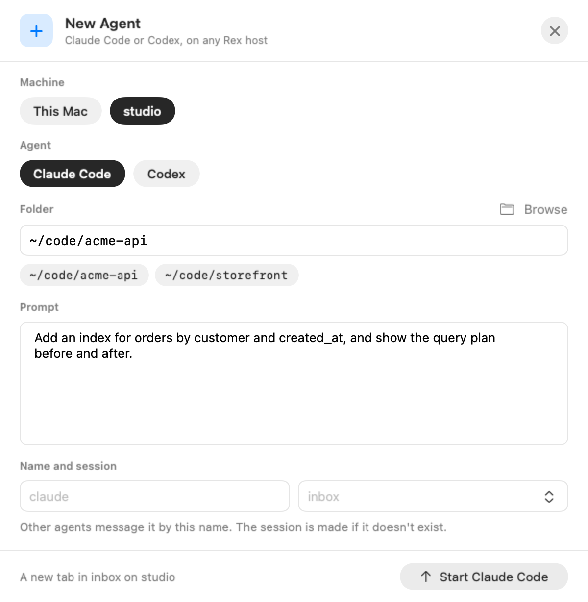
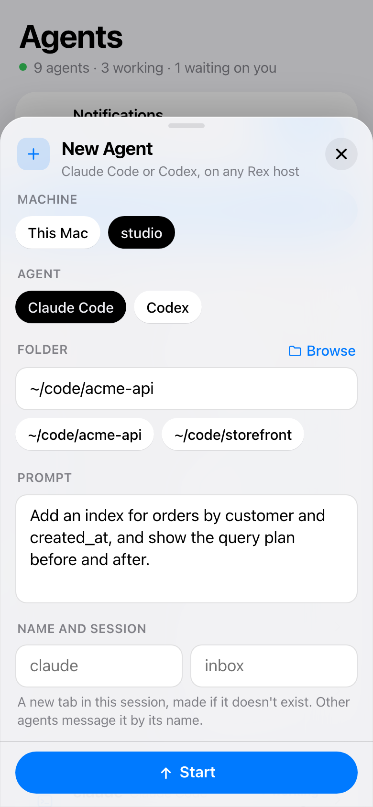

# rex-inbox


Everything your Rex agents need from you, and messages between them.

[Rex](https://www.superlogical.com/rex) already runs your agents' panes and
knows what each one is doing: Claude Code and Codex report `working`,
`blocked`, `done` and `error` on their own (OSC 7501). rex-inbox turns that
into one inbox, lets agents message each other and you, and lets you
answer permission prompts without going to the pane. It also starts new
agents, on this Mac or any machine in `rex hosts`, and says what each
agent did when it finished.

The idea comes from [Plannotator](https://github.com/backnotprop/plannotator)'s
[Inbox](https://plannotator.ai/inbox), by [@backnotprop](https://github.com/backnotprop).
See [Inspiration](#inspiration).

```
$ rex-inbox ls
Needs you
  #17  permission  Claude Code  solar-isle/alpha  ~/git/app  12s  approve Bash: rm approved.txt
Finished
  #12              Claude Code  restless-cliff/shell  ~/git/web  4m   Fixed the flaky retry test. Tests pass. Not committed
Messages
  #7   unread  from solar-isle/planner  1m  Pick a cache

$ rex-inbox approve 17
#17 approved; the pane is now working
```

> Rex is in private beta. rex-inbox needs a Rex build whose agents report
> program status: Claude Code and Codex do on their own.

## Requirements

- macOS and Rex
- Rust (edition 2024), for the hub and the CLI
- Swift 6 (Xcode or its command line tools), for the Mac app
- Optional: `terminal-notifier`, for clickable notifications when the Mac
  app isn't running; `jq` and `sqlite3`, for `scripts/demo.sh`; those plus
  Node 22 or later and Google Chrome, for `scripts/screenshots.sh`

## Install

```sh
git clone https://github.com/captjt/rex-inbox ~/src/rex-inbox
cd ~/src/rex-inbox
cargo install --path .
rex-inbox up              # the hub, as a LaunchAgent (logs: rex-inbox logs)
rex-inbox hooks install   # agents say what they did when they finish
mac/build.sh              # Rex Inbox.app, in ~/Applications
```

With agents on other machines too, load rex-inbox's Rex action (see
[Agents on other machines](#agents-on-other-machines)).

macOS only for now. The hub talks to Rex only through the `rex` CLI.
Agents use it through the same CLI: `rex-inbox send`, `inbox`, `read`, and
`wait`.

## The Mac app

A tray in the menu bar turns orange with a count while something needs
you. Its panel is a quick look; the window button opens a full window with
a sidebar (Everything, Needs You, Messages, Failed, Finished, Agents). The
app shows in the Dock while that window is open. The ＋ starts an agent
(see [Starting agents](#starting-agents-on-any-machine)).

<table>
  <tr>
    <td valign="top">
      <picture>
        <source media="(prefers-color-scheme: dark)" srcset="docs/images/inbox-dark.png">
        
      </picture>
    </td>
    <td valign="top">
      <picture>
        <source media="(prefers-color-scheme: dark)" srcset="docs/images/agents-dark.png">
        
      </picture>
    </td>
  </tr>
</table>

<sub>The agents and PRs are made up. <code>scripts/screenshots.sh</code> renders these again from a made-up Rex.</sub>

- **Inbox:** approve or deny a prompt, reply to a message, open the pane in
  Rex, snooze, or mark done.
- **Agents:** every agent pane by session, this Mac's first, then each
  other machine's; click one to open it, or message it. A finished agent
  shows what it said last.
- **Notifications** carry the answer: Approve and Deny, Post and Dismiss
  for a review, or Reply.

`RexInbox --snapshot out.png [--tab agents] [--window | --new-agent]`
renders the panel (or the window, or the New Agent form) to a PNG without
opening anything on screen.

`scripts/demo.sh up` fills your inbox with a made-up project (a Rex session
`acme-api` of stand-in agents, and two messages to you), to try the app
without real agents; `scripts/demo.sh down` removes it.

## On your phone

The hub also serves a web app. Publish it on your tailnet, then add it to
your Home Screen for notifications. It needs no App Store and no
developer account.

<p>
  
  &nbsp;
  
</p>

```sh
brew install --cask tailscale-app   # sign in; same tailnet as the phone
# Tailscale admin console: turn on MagicDNS and HTTPS certificates
tailscale serve --bg 7430
rex-inbox web                       # prints the phone's address
```

Open that address in Safari, choose Share › Add to Home Screen, open it
from the Home Screen, and tap Turn On. Only your own Tailscale user gets
in. Web notifications on iOS have no buttons, so tap one, then approve in
the app.

The inbox lists every agent that's running, under Running, until it needs
you. Tap an agent for its pane as a conversation: what you asked in
bubbles, what it said, each tool it ran as a row that opens to its output,
and Approve and Deny at the top when it waits on you. It follows the pane
while it's open; Screen shows the terminal as it is. A session's pencil
renames it, on the phone and in the Mac app.

## Commands

| | |
| --- | --- |
| `ls [--all] [--history]` | What needs you: blocked, failed and finished agents, and messages to you. |
| `agents [--all]` | Every agent pane, where it is, and what it's doing. |
| `show N [--screen]` | One item; `--screen` adds the bottom of its pane. |
| `approve N`, `deny N` | Answer a permission prompt, only if it's still the one `N` shows. For a review [rex-reviewer](#with-rex-reviewer) has ready: post it, or dismiss it. |
| `preview N` | A review rex-reviewer has ready, as it would post. |
| `open N` | Bring the item's pane to the front in Rex. |
| `done N`, `snooze N 1h`, `reopen N` | File an item. |
| `start [--on HOST] [--codex] [-C DIR] [--name N] [-s SESSION] [PROMPT\|-]` | Start Claude Code (or Codex) in a new tab, here or on another Rex host. |
| `hosts` | The machines the hub follows, and whether each is reachable. |
| `hooks [install\|remove]` | The agents' Stop hooks, which put what an agent said when it finished on its Finished item. |
| `rpc [REQUEST]` | Answer one request from this machine's hub (what `inbox_rpc` runs). |
| `send --to NAME [--subject S] TEXT\|-` | Message an agent's pane (`reviewer`, `session/pane`, a block id) or `me`. |
| `reply N TEXT\|-` | Answer a message; it goes to the other side. |
| `inbox`, `read N`, `wait [--thread N] [--timeout S]` | An agent's own messages. |
| `name NAME`, `whoami` | Name this pane so others can reach it. |
| `web` | The phone web app's address, and how to publish it. |
| `status`, `watch`, `up`, `down`, `logs` | The hub. |

## Starting agents, on any machine

The ＋ in the menu bar panel, New Agent in the window's toolbar, and New
Agent on the phone's Agents tab all start an agent. On the Mac, the form
takes the panel's place (a sheet over the window); on the phone, it's a
sheet. Pick the machine and the agent, then the folder there and what to
do, and press Start (⌘↩ on the Mac).

<table>
  <tr>
    <td valign="top">
      <picture>
        <source media="(prefers-color-scheme: dark)" srcset="docs/images/new-agent-dark.png">
        
      </picture>
    </td>
    <td valign="top">
      <picture>
        <source media="(prefers-color-scheme: dark)" srcset="docs/images/phone-new-agent-dark.png">
        
      </picture>
    </td>
  </tr>
</table>

So does the CLI:

```
$ rex-inbox start --on studio -C ~/code/api "Fix the flaky retry test"
Started Claude Code as studio:inbox/claude in ~/code/api
```

- **Machines** are this Mac and every host in `rex hosts`. The hub follows
  each one and picks up a host added or removed within 30 seconds, so their
  agents show under Agents and their prompts reach your inbox. To add one,
  run `rex hosts add LABEL ENDPOINT`, with Rex running on that machine.
- **What it runs** is Claude Code or Codex only, with your prompt as its
  first instruction. Without a prompt, the agent waits in its pane.
- **Where it goes** is a new tab in the host's `inbox` session, or in a
  session you name. The session is created if it doesn't exist. The pane is
  named `claude`, `claude-2`, and so on (or the name you give), so other
  agents can message it.
- **The folder** must exist on that machine. Pick from the folders its
  agents are in, or browse its folders from the app or the phone.

If an agent the inbox started reports nothing for 8 seconds, it's held at
a prompt before it starts, such as Codex or Claude Code asking whether to
trust a new folder. That becomes a **needs you** item. Answer it in Rex,
and the item clears once the agent starts.

### Agents on other machines

Agents there take messages, and their prompts are approved like any other.
For them to use `rex-inbox` themselves (send, reply, read, wait), two
things are needed:

1. **On the hub's machine**, load rex-inbox's Rex action, then run
   `rex config reload`. Add this to your Rex `init.lua`:

   ```lua
   dofile(os.getenv("HOME") .. "/src/rex-inbox/rex/init.lua")
   ```

   It defines `inbox_rpc`, which hands one request to the hub.
   `rex-inbox status` warns when the hub follows other hosts but the
   action isn't loaded.
2. **On the other machine**, install the `rex-inbox` CLI (`cargo install
   --path .`, but don't run `up`). With no hub of its own, it reaches the
   hub through `rex -S HOME do inbox_rpc`. HOME is that machine's Rex home,
   or `REX_INBOX_VIA` when set. Rex carries the request and decides who may
   make it, so no ports are opened.

The hub knows which pane is calling from its block id, which is unique
across Rex servers. Without the CLI there, an agent answers a message in
its pane, where you can read it.

## How it works

- **Alerts** mirror program status. A `blocked` record becomes **needs you**,
  `error` becomes **failed**, and a root `done` becomes **finished**. Each
  clears itself when the record changes or the pane closes. Rex drops `done`
  once you visit the pane.
- **What a finished agent did** comes from its own Stop hook (see
  [What agents report when they finish](#what-agents-report-when-they-finish)).
- **Messages** queue in the hub. A message is pasted into an agent's prompt
  (then Enter) once the pane has been `idle` or `done` for two seconds. Plain
  shell panes are never typed into.
- **Approve and deny** re-read the prompt from Rex first. Keys go only if
  it's the same `blocked` permission record, with the same message and
  report time, and the only prompt in that pane. Claude Code gets `1` and
  Escape. Other agents can only be opened, until their prompts are checked.
- **Notifications** cover needs you, failed, and messages to you. Each
  waits two seconds, and is dropped if you already answered.

## What agents report when they finish

Program status says *that* an agent finished, not what it did. Both
Claude Code and Codex run a Stop hook as each turn ends, with the agent's
last message. Install rex-inbox's hook on each machine with agents:

```
$ rex-inbox hooks install
Claude Code  added the Stop hook to ~/.claude/settings.json
Codex        added the Stop hook to ~/.codex/hooks.json
Codex        Codex asks you to trust the new hook once: answer it when it starts
```

From then on, an agent's Finished item says what it said last, in a
paragraph of up to 300 characters: in `ls`, in the apps, and under Agents.
The summary goes when the agent's next turn starts.

- **Beside your other hooks.** It adds one entry at the end of `Stop`,
  writes through symlinks, and keeps the rest of each file as it was.
  `rex-inbox hooks remove` takes it out again; `rex-inbox hooks` shows where
  it stands, and `rex-inbox status` says when it's missing.
- **It never holds up the agent.** The hook prints nothing, always exits 0,
  and sends in the background. Outside a Rex pane it does nothing. Sends
  that fail are logged to `hook.log` in the state folder.
- **Other machines** send it to the hub through `inbox_rpc`, like
  everything else (see [Agents on other machines](#agents-on-other-machines)).
- **Agents already running** pick it up when they next start.

The hook makes the summary as good as the agent's last message. To make
that a summary, and to have agents leave notes and messages through the
inbox, say so in your global agent instructions (`~/.claude/CLAUDE.md`,
`~/.codex/AGENTS.md`), for example:

```markdown
## Rex inbox

In a Rex pane (REX_SESSION is set), rex-inbox reaches the user and other agents.

- End a finished task with a short summary: what changed, how it was checked,
  and what's left. The inbox shows your last message on its Finished item.
- When you need a decision and the user may be away, or they should know
  something later, leave a note: `rex-inbox send --to me "..."`.
- To work with other agents, use the rex-inbox skill. Answer a
  "[rex-inbox] Message #N" with `rex-inbox reply N`.
```

## With rex-reviewer

[rex-reviewer](https://github.com/captjt/rex-reviewer) runs agent PR
reviews in Rex. rex-inbox doesn't need it, and it doesn't need rex-inbox.
When both run:

- **A review ready to post is an item.** It has **Post**, **Dismiss**, and
  **Preview**, in the app, in its notification, and on the phone. **Open**
  shows the PR's tab. As with prompts, nothing happens unless the item is
  still the one you saw, and rex-reviewer refuses once the round has moved on.
- **Its agents report through it.** The reviewer and checker panes add no
  Finished items, since the round moves on without you. They aren't listed
  under Agents and take no messages. Their prompts and failures name the PR,
  such as `api#12 · codex reviewer`, and you answer the prompts as usual.
- **One icon alerts you.** rex-reviewer's menu bar app stops badging what
  needs you while the hub runs.

It works through what each one already publishes:
- rex-reviewer's watcher reports one program status record per PR
  (`app=rex-reviewer`).
- Its Rex actions take a record's id (`rex do reviewer_post item=…`).
- Its ledger in `~/.local/state/rex-reviewer` says which panes are its.

On another host, where the hub can't read that ledger, the agents in a
session with a rex-reviewer pane count as its.

## State

State lives in `~/.local/state/rex-inbox` (SQLite and the hub's socket).
See [DESIGN.md](DESIGN.md) for the decisions and what comes next.

## Inspiration

rex-inbox started from [Plannotator](https://github.com/backnotprop/plannotator)'s
[Inbox](https://plannotator.ai/inbox), by [@backnotprop](https://github.com/backnotprop).
There, your agents' questions, blockers, plans and diffs collect in one
place while they keep working. You get to them when you're ready, and each
agent carries on with your answer. rex-inbox brings that idea to agents
running in Rex:
- the inbox fills from what the agents already report to Rex;
- you can answer permission prompts from it;
- it follows you to your phone.

Thanks to @backnotprop for the idea, and for showing how well it works.

## License

MIT. See [LICENSE](LICENSE).
